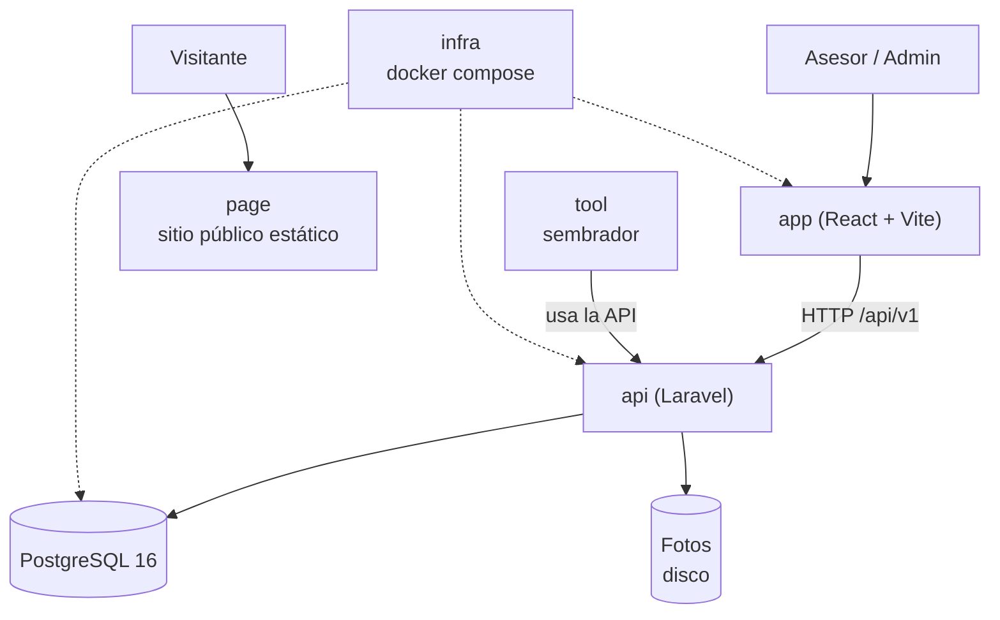
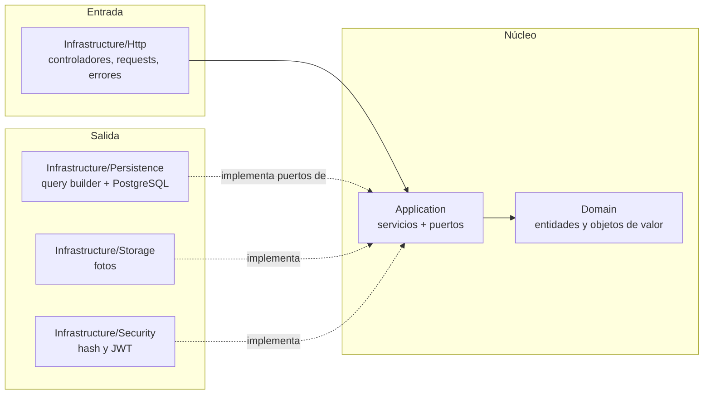
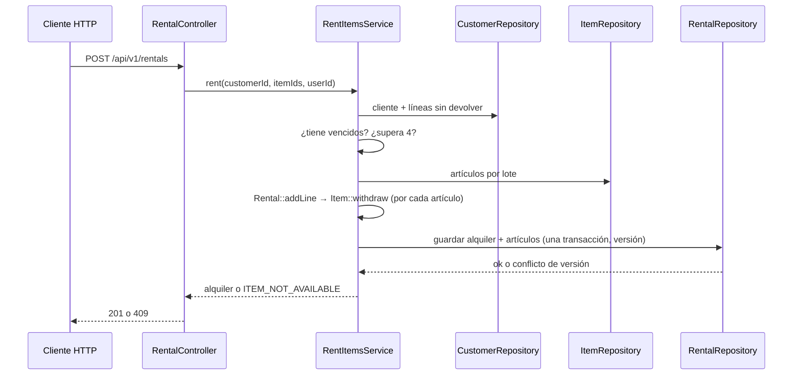

# Arquitectura — Camping Rental (Laravel + React)

Arquitectura **hexagonal** (puertos y adaptadores) dentro de un proyecto Laravel. Las reglas de dependencia son los
artículos I a III de [`constitution.md`](constitution.md).

## 1. El sistema en una imagen



| Carpeta | Papel | Se prueba con |
|---|---|---|
| `docs` | La especificación | Que esta lectura baste para construir |
| `api` | Reglas de negocio y contrato HTTP | Pruebas de dominio, aplicación, contrato, concurrencia y arquitectura |
| `app` | Pantallas de operación | Recorrido: login → alquilar → devolver → reporte |
| `page` | Presentación pública, sin llamar a la API | Que se vea bien en móvil y escritorio |
| `infra` | `docker compose up` y la base vacía | Que arranca con un solo comando |
| `tool` | Datos de demostración por la API | Que haya vencidos y filas en el reporte |

## 2. Capas y dependencias del backend



Las flechas apuntan **hacia adentro**. `PortBindingsServiceProvider` es el único que ve las dos mitades.

## 3. Estructura de carpetas (`api/`)

```text
app/
├── Domain/                # Item, Rental, RentalLine, Customer, User, Role, RentalStatus
│   ├── ValueObjects/      # ItemReference, Quantity, DocumentNumber, DateRange
│   └── Exceptions/        # DomainException y sus subclases con código de negocio
├── Application/
│   ├── Ports/             # ItemRepository, RentalRepository, CustomerRepository, UserRepository,
│   │                      # ReportReader, Clock, PasswordHasher, TokenIssuer, PhotoStorage
│   └── Services/          # LoginService, CreateAdvisorService, CreateItemService, UpdateItemService,
│                          # DeactivateItemService, SearchItemsService, ItemPhotoService,
│                          # CreateCustomerService, RentItemsService, ReturnItemService,
│                          # OverdueService, MostRequestedReportService
├── Infrastructure/
│   ├── Http/              # Controllers/, Middleware/ (JwtAuthenticate, RequireRole), ErrorRenderer
│   ├── Persistence/       # Db*Repository, DbReportReader
│   ├── Storage/           # DiskPhotoStorage
│   └── Security/          # Argon2PasswordHasher, JwtTokenIssuer, SystemClock
└── Providers/
    └── PortBindingsServiceProvider.php   # único punto de composición
```

## 4. Entidades raíz

| Raíz | Contiene | Invariantes que defiende |
|---|---|---|
| `Item` | `ItemReference`, unidades totales y disponibles, baja lógica | disponibles entre 0 y total; total ≥ 1; nombre no vacío |
| `Rental` | colección de `RentalLine` | 1 a 4 líneas; sin artículo repetido; vencimiento a 6 días; inmutable salvo devolución |
| `Customer` | `DocumentNumber` | documento obligatorio y único |
| `User` | rol, hash | nombre normalizado; rol en (`admin`, `advisor`) |

`Rental::addLine()` llama a `Item::withdraw()` antes de añadir la línea: descontar la unidad y crear la línea son
**una sola operación**. `Rental::returnLine()` llama a `Item::restock()` una sola vez por línea.

## 5. Flujo: registrar un alquiler



## 6. Errores

El dominio y la aplicación lanzan excepciones propias (`ItemNotAvailable`, `CustomerHasOverdue`,
`CustomerLimitExceeded`, …), cada una con su `code` y su mensaje en español. **Solo** `Infrastructure/Http/ErrorRenderer`
las traduce al cuerpo único y al estado HTTP de [`api-contract.md`](api-contract.md). Un error de framework nunca llega
al cliente con su traza.

## 7. Frontend (`app/`)

```text
src/
├── api/client.js          # fetch con token y manejo del cuerpo de error
├── auth/                  # AuthContext, ProtectedRoute
├── pages/                 # LoginPage, ItemsPage, ItemFormPage, CustomersPage, RentalFormPage,
│                          # RentalsPage, RentalDetailPage, OverduePage, ReportPage, AdvisorFormPage
└── components/            # Pagination, ErrorMessage, StatusBadge
```

Componentes, funciones y variables en inglés; textos visibles en español.

## 8. Qué no hay

Sin eventos, sin colas, sin caché, sin microservicios, sin multi-sede. Se añaden si un requisito lo pide, no antes.
