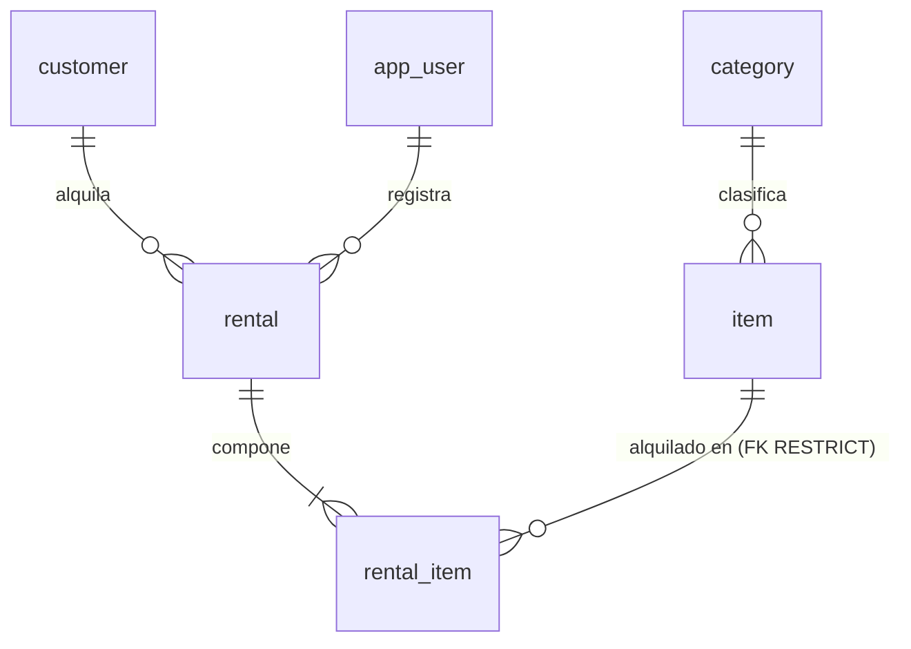

# Modelo de datos — Camping Rental

**El único sitio donde vive el modelo de datos.** Quien implemente no necesita abrir el código ni conectarse al motor
para saber qué hay, de qué tipo y con qué regla.

- Motor: PostgreSQL 16. Esquema `public`. Servidor en UTC.
- Rige bajo [`constitution.md`](constitution.md) y [`spec.md`](spec.md).

Cada regla lleva una de **tres marcas**: **motor** (la impone la base), **solo dominio** (solo el código),
**pendiente (T-xx)** (la pone esa tarea de [`tasks.md`](tasks.md)).

---

## 0. Convención de nombres

| Elemento | Convención | Ejemplo |
|---|---|---|
| Tabla | `snake_case`, inglés, **singular** | `rental_item` |
| Columna | `snake_case`, inglés, singular, ASCII | `due_at` |
| Restricción escrita a mano | `ck_{tabla}_{regla}` | `ck_item_available_range` |

El usuario interno se guarda en `app_user` para no chocar con la palabra reservada `user` de PostgreSQL.

## 1. Glosario

| Término | Definición | Dónde vive |
|---|---|---|
| **Artículo** | Equipo del catálogo (carpa, saco, estufa…) con referencia, categoría, unidades y foto opcional | `item` |
| **Referencia** | Código `AAA-0000` que identifica al artículo en el negocio | `item.reference` |
| **Categoría** | Una de cinco fijas, sembradas, sin mantenimiento | `category` |
| **Unidad** | Pieza física de un artículo. Se cuenta, no se identifica | `item.total_units`, `item.available_units` |
| **Cliente** | Persona que alquila. No inicia sesión | `customer` |
| **Alquiler** | Hecho consumado: quién alquiló, quién lo registró y cuándo | `rental` |
| **Línea de alquiler** | Un artículo dentro de un alquiler, con su vencimiento y su devolución | `rental_item` |
| **Estado del alquiler** | `open`, `overdue` o `closed`. **Se calcula, no se almacena** | sin columna |
| **Usuario** | Operador interno con rol `admin` o `advisor` | `app_user` |
| **Congelado** | Copia del valor en el instante del alquiler; no sigue al catálogo | `rental_item.item_name`, `reference`, `category_name` |

## 2. Entidades y relaciones



Seis entidades, seis tablas de negocio. No hay tabla de reporte, de cobros ni de auditoría.

## 3. Modelo físico

Ninguna columna de negocio lleva `DEFAULT`: los valores los pone el dominio.

**`category`** — semilla de solo lectura.

| Columna | Tipo | Nulable | Nota |
|---|---|---|---|
| `id` | `uuid` | no | PK. Identificadores fijos (ver §9) |
| `name` | `varchar(120)` | no | Único |

**`item`**

| Columna | Tipo | Nulable | Nota |
|---|---|---|---|
| `id` | `uuid` | no | PK |
| `name` | `varchar(150)` | no | Recortado por el dominio |
| `description` | `varchar(300)` | no | Descripción corta |
| `reference` | `char(8)` | no | Formato `AAA-0000`. Única entre activos (índice parcial) |
| `category_id` | `uuid` | no | FK restrictiva a `category` |
| `total_units` | `integer` | no | ≥ 1 |
| `available_units` | `integer` | no | Entre 0 y `total_units` |
| `version` | `integer` | no | Testigo de concurrencia optimista ([ADR-002](adr/adr-002-optimistic-concurrency.md)) |
| `photo_key` | `varchar(512)` | **sí** | Clave opaca; nunca ruta ni bytes; nunca cadena vacía |
| `deleted_at` | `timestamptz` | sí | Baja lógica. Nula = activo |

**`customer`**

| Columna | Tipo | Nulable | Nota |
|---|---|---|---|
| `id` | `uuid` | no | PK |
| `full_name` | `varchar(200)` | no | |
| `document_number` | `varchar(30)` | no | Único |

**`rental`**

| Columna | Tipo | Nulable | Nota |
|---|---|---|---|
| `id` | `uuid` | no | PK |
| `customer_id` | `uuid` | no | FK restrictiva a `customer` |
| `rented_by_user_id` | `uuid` | no | FK restrictiva a `app_user` |
| `rented_at` | `timestamptz` | no | Instante del alquiler |

**`rental_item`**

| Columna | Tipo | Nulable | Nota |
|---|---|---|---|
| `id` | `uuid` | no | PK |
| `rental_id` | `uuid` | no | FK con `ON DELETE CASCADE` |
| `item_id` | `uuid` | no | FK restrictiva a `item` |
| `item_name` | `varchar(150)` | no | Congelado; mismo ancho que `item.name` |
| `reference` | `char(8)` | no | Congelado |
| `category_name` | `varchar(120)` | no | Congelado; **sin FK a propósito** |
| `due_at` | `timestamptz` | no | `rented_at` + 6 días, calculado por el dominio |
| `returned_at` | `timestamptz` | **sí** | Nula mientras no se devuelve |

**`app_user`**

| Columna | Tipo | Nulable | Nota |
|---|---|---|---|
| `id` | `uuid` | no | PK |
| `username` | `varchar(120)` | no | Único, minúsculas, recortado |
| `password_hash` | `varchar(512)` | no | Nunca se indexa |
| `role` | `varchar(40)` | no | `admin` o `advisor` |

Reglas transversales: **todas las marcas de tiempo son `timestamptz`**; **no hay columnas de auditoría**
(`created_at`/`updated_at`) porque ningún requisito las pide. La tabla `migrations` es de Laravel y no es de negocio.

## 4. Restricciones e índices: dónde vive cada regla

| Regla | Objeto | Marca |
|---|---|---|
| Claves primarias de las seis tablas | PK | **motor** |
| `category.name` único | índice único | **motor** |
| `customer.document_number` único | índice único | **motor** |
| `app_user.username` único | índice único | **motor** |
| `reference` única entre activos | índice único parcial `WHERE deleted_at IS NULL` | **motor** |
| `item.category_id` → `category.id` RESTRICT | FK | **motor** |
| `rental.customer_id` → `customer.id` RESTRICT | FK | **motor** |
| `rental.rented_by_user_id` → `app_user.id` RESTRICT | FK | **motor** |
| `rental_item.rental_id` → `rental.id` CASCADE | FK | **motor** |
| `rental_item.item_id` → `item.id` RESTRICT | FK | **motor** |
| `0 <= available_units <= total_units` | `ck_item_available_range` | **motor** — última barrera de concurrencia |
| `total_units >= 1` | `ck_item_total_positive` | **pendiente (T-18)** · hoy solo dominio |
| Único `(rental_id, item_id)` | índice único | **motor** |
| `role` en (`admin`,`advisor`) | `ck_app_user_role` | **pendiente (T-18)** · hoy solo dominio |
| Máximo 4 sin devolver por cliente | — | **solo dominio** (no expresable en un `CHECK`) |
| Cliente con vencidos no alquila | — | **solo dominio** |
| Descontar unidad y crear línea son una operación | — | **solo dominio** (una transacción) |
| Un alquiler tiene 1 a 4 líneas | — | **solo dominio** |
| Alquileres y devoluciones inmutables salvo `returned_at` | — | **solo dominio** (por ausencia de operación) |

Índices de acceso: `item (category_id, name)` parcial sobre activos; `rental (rented_at)`; `rental_item (item_id)`;
`rental_item (due_at) WHERE returned_at IS NULL` para vencidos.

## 5. Política de claves foráneas

| # | FK | `ON DELETE` | Por qué |
|---|---|---|---|
| FK-1 | `item.category_id` | RESTRICT | Una categoría con artículos no se elimina |
| FK-2 | `rental_item.rental_id` | CASCADE | Composición (nunca se dispara: no se borran alquileres) |
| FK-3 | `rental_item.item_id` | RESTRICT | Un borrado manual no puede dejar huérfano el histórico |
| FK-4 | `rental.customer_id` | RESTRICT | El cliente de un alquiler no desaparece |
| FK-5 | `rental.rented_by_user_id` | RESTRICT | La autoría es un dato contable |

## 6. Patrones de acceso

| # | Patrón | Frecuencia |
|---|---|---|
| Q1 | Buscar artículos (texto, categoría, activos, orden por nombre, paginado) | Alta |
| Q2 | Artículo por id | Alta |
| Q3 | Artículos por lote de ids (antes de alquilar) | Alta, punto de contención |
| Q4 | Listar categorías | Alta |
| Q5 | Alquiler con sus líneas | Media |
| Q6 | Alquileres por rango, estado y cliente | Alta |
| Q7 | Líneas sin devolver de un cliente (cuenta y vencidos) | Alta, en cada alquiler |
| Q8 | Vencidos globales | Media |
| Q9 | Reporte: más solicitados por rango | Alta, la más costosa |
| Q10 | Usuario por nombre | Alta, en cada inicio de sesión |

## 7. Privacidad y retención

| Tabla | Atributo | Clasificación | Manejo |
|---|---|---|---|
| `app_user` | `username` | Dato personal | Acceso restringido |
| `app_user` | `password_hash` | **Secreto** | Jamás en logs ni respuestas; nunca se indexa |
| `customer` | `full_name`, `document_number` | **Dato personal** | Solo `admin` y `advisor`; **nunca** en el reporte |
| `rental`, `rental_item` | todos | Comerciales | Retención indefinida |
| `item`, `category` | todos | Públicos | Baja lógica / sin borrado |

**Retención:** alquileres y líneas nunca se borran; artículos solo baja lógica; el binario de la foto es el **único** dato
que se borra físicamente: primero se anula `photo_key` y se confirma la transacción; después se borra el archivo.

## 8. Auditoría

No hay `created_at`/`updated_at`. Los instantes de negocio ya tienen columna: `rental.rented_at`,
`rental_item.returned_at` e `item.deleted_at`.

## 9. Estrategia de semilla

Las **cinco categorías** van en la migración inicial, con identificadores fijos:

| `id` | `name` |
|---|---|
| `11111111-1111-4111-8111-111111111111` | Carpas |
| `22222222-2222-4222-8222-222222222222` | Dormir |
| `33333333-3333-4333-8333-333333333333` | Cocina |
| `44444444-4444-4444-8444-444444444444` | Iluminación |
| `55555555-5555-4555-8555-555555555555` | Mochilas |

El **administrador inicial no lo siembra la base**: lo crea `php artisan app:create-admin` con credenciales de entorno.
El sembrador de demostración (`tool`) usa la **API**, nunca SQL directo.

## 10. Cómo se comprueba que este documento no miente

```sql
-- Columnas de §3, sin ningún DEFAULT
SELECT table_name, ordinal_position, column_name, data_type, is_nullable, column_default
FROM information_schema.columns
WHERE table_schema = 'public' AND table_name IN ('category','item','customer','rental','rental_item','app_user')
ORDER BY 1, 2;

-- Restricciones: PK, FK y CHECK
SELECT c.conrelid::regclass, c.conname, c.contype, pg_get_constraintdef(c.oid)
FROM pg_constraint c JOIN pg_namespace n ON n.oid = c.connamespace
WHERE n.nspname = 'public' ORDER BY 1, 3, 2;

-- Índices
SELECT tablename, indexname, indexdef FROM pg_indexes WHERE schemaname = 'public' ORDER BY 1, 2;
```

Si una regla marcada **motor** no aparece, alguien la borró. Si una marcada **solo dominio** aparece, ya se bajó y hay
que reclasificarla. Gana el motor: el documento está roto y se corrige el documento.
